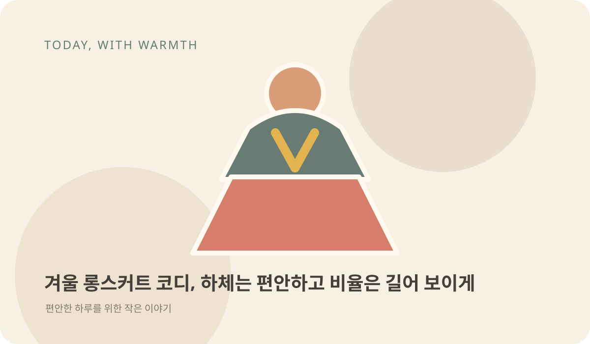

# 겨울 롱스커트 코디, 하체는 편안하고 비율은 길어 보이게

> **한 줄 요약:** 롱스커트는 길이 하나만으로 체형을 가리지 않아요. 허리 위치와 상의 분량, 치맛단의 움직임을 함께 맞추면 따뜻하면서도 한결 단정한 겨울 차림이 됩니다.

> 이미지: 글 주제에 맞춰 매거진에서 직접 만든 그림입니다.

겨울 옷장을 열면 따뜻한 바지와 롱스커트 사이에서 잠시 망설이게 돼요. 치마는 편하고 예쁘지만, 두꺼운 상의를 함께 입으면 몸이 짧아 보일까 걱정되기도 하지요. **핵심은 날씬해 보이려고 억지로 조이는 것이 아니라, 위아래 옷의 길이와 무게를 고르게 나누는 데 있어요.**

**2026년 11월 19일 수능일에는 아침 체감온도가 영하권으로 예상된다는 정부 발표가 있었어요.** 추운 날에는 멋을 위해 얇게 입기보다, 얇은 옷을 겹쳐 입고 실내에서 벗기 쉽게 준비하는 편이 실용적입니다.

| 입는 방식 | 어울리는 상황 | 입기 전 확인 |
|---|---|---|
| 허리선이 보이는 짧은 상의 | 다리 비율을 길어 보이게 하고 싶을 때 | 허리 밴드가 배를 누르지 않는지 |
| 엉덩이를 덮는 중간 길이 상의 | 편안한 가림과 활동성을 함께 원할 때 | 상의 밑단과 치맛단이 한 덩어리처럼 겹치지 않는지 |
| 긴 겉옷과 세로로 열린 앞선 | 바람을 막고 차분한 분위기를 원할 때 | 걸을 때 치마가 발목에 걸리지 않는지 |

**표는 정답이 아니라 옷을 고를 때 비교할 출발점이에요.** 몸의 높이와 허리 위치, 치마 폭에 따라 같은 길이도 다르게 보일 수 있습니다.

## 롱스커트 길이는 어디까지가 편할까요?

**거울 앞에서 치맛단이 발목을 완전히 덮는지, 걸을 때 발에 닿는지 먼저 확인해보세요.** 길이가 발등까지 내려오면 우아해 보일 수 있지만, 계단이나 횡단보도에서는 치맛단이 걸리지 않는지 살펴야 해요.

**발목을 드러낼지 덮을지는 키보다 안전과 걸음의 편안함을 먼저 기준으로 삼으세요.** 낮은 신발을 자주 신는다면 바닥에 끌리지 않는 길이가 좋고, 실내외에서 신발을 바꾼다면 그 높이까지 고려해 기장을 맞추면 편합니다.

**치마 폭도 중요해요.** 너무 좁으면 보폭이 짧아지고, 지나치게 넓으면 걸을 때 옷감이 크게 흔들릴 수 있어요. 앉았다 일어나고 한두 걸음 걸어보며 허벅지와 무릎이 편하게 움직이는지 확인하세요.

**치마를 입고 두 걸음만 걸어봐도 길이와 폭의 불편함이 훨씬 잘 드러납니다.** 매장 피팅룸에서 서 있는 모습만 보고 고르지 말고, 앉고 걷는 동작도 해보세요.

## 상의와 허리선을 정리하는 쉬운 방법

**상체가 짧게 느껴지거나 배가 편해야 한다면, 허리선을 무조건 높게 잡기보다 옷을 입었을 때 자연스럽게 생기는 선을 찾으세요.** 상의를 앞부분만 살짝 넣거나, 허리선이 드러나는 짧은 겉옷을 걸쳐 중심을 정돈할 수 있어요.

**배를 조이는 밴드보다 오래 앉아도 숨이 편한 허리 구조가 먼저입니다.** 식사 자리나 장시간 이동이 있는 날에는 고무 밴드가 살짝 늘어나는지, 앉았을 때 복부를 누르지 않는지 확인하세요.

**엉덩이를 가리는 옷이 마음 편하다면 상의 밑단이 치마와 같은 위치에 오지 않도록 해보세요.** 상의가 치맛단과 비슷한 길이에서 끝나면 허리와 엉덩이 경계가 흐려져 전체가 짧고 넓게 보일 수 있어요.

**상의 앞을 조금 열어 세로선을 만들거나, 안쪽 옷을 한 톤 밝게 두면 시선이 자연스럽게 위아래로 흐릅니다.** 색을 꼭 맞춰 입지 않아도 괜찮아요. 겉옷과 치마 중 한쪽만 차분한 색으로 두면 조화가 쉬워집니다.

**목도리나 장신구를 더할 때는 얼굴 가까이에 한 가지 포인트만 둬도 충분합니다.** 큰 목도리와 풍성한 상의, 넓은 치마를 한꺼번에 겹치면 따뜻하더라도 상체가 묵직해 보일 수 있어요.

## 겨울 소재와 색을 고르는 법

**겨울 치마는 도톰한 니트, 울 혼방, 기모가 있는 소재 등 선택지가 많아요.** 손으로 만졌을 때 따뜻한지만 보지 말고, 안감이 다리에 달라붙지 않는지, 정전기가 쉽게 생기지 않는지도 확인해보세요.

**소재가 두껍다고 늘 더 따뜻하거나 더 날씬해 보이는 것은 아닙니다.** 실내에서 오래 지내는 날에는 지나치게 무거운 원단보다 얇은 옷을 겹쳐 입는 편이 체온 조절하기 쉽습니다.

**색은 머리부터 발끝까지 모두 어둡게 맞출 필요가 없어요.** 치마와 겉옷 중 한쪽을 짙은 색으로 두고, 얼굴 가까이에 부드러운 색을 더하면 전체가 단정해 보입니다. 무늬가 있는 치마를 고를 때는 상의 색을 무늬 안의 한 가지 색과 맞추면 정돈하기 쉬워요.

**색을 세 가지 안팎으로 정리하면 옷장 속 다른 옷과도 돌려 입기 좋습니다.** 새 옷을 사기 전에는 이미 가진 겉옷, 니트, 가방과 실제로 맞춰 입어보세요.

## 거울 앞에서 체형에 맞게 조정하는 순서

**먼저 평소 신는 신발을 신고 옆모습과 정면을 함께 살펴보세요.** 허리선이 편한지, 상의 밑단이 치마와 한 줄로 뭉쳐 보이지 않는지, 코트 단추를 잠갔을 때 움직임이 자연스러운지를 차례로 확인하면 어디를 바꾸면 좋을지 알기 쉬워요.

**한 번에 모든 옷을 바꾸기보다 길이·색·폭 중 한 가지만 조정해보세요.** 상의를 조금 걷어 올리거나 목도리를 가볍게 두르는 것처럼 작은 변화부터 보면 평소 옷장에 있는 옷을 더 오래 활용할 수 있습니다.

**오래 서 있거나 대중교통을 타는 날에는 따뜻함과 무게도 중요한 기준이에요.** 가방에 여벌의 얇은 양말이나 목도리를 넣고, 실내에서 겉옷을 벗었을 때도 부담스럽지 않은 차림인지 생각해보세요.

**실내외 온도 차가 큰 날은 벗고 입기 쉬운 겹쳐 입기가 편합니다.** 두꺼운 옷 한 벌에 기대기보다 얇은 내의와 니트, 겉옷을 조합하면 상황에 맞게 조절하기 쉬워요.

**매장에서 살 때는 치마를 입은 채 평소 가방을 메고 앉았다 일어나보세요.** 허리 밴드가 말리거나 안감이 달라붙는지, 겉옷을 입었을 때 어깨와 허리 주변이 답답하지 않은지 함께 확인할 수 있습니다.

**옷걸이에 걸린 모양보다 내 몸으로 움직였을 때의 편안함이 더 정확한 선택 기준입니다.** 같은 치마라도 상의 소재와 신발 높이를 바꾸면 인상이 달라지니, 새 옷을 사기 전에 집에 있는 옷과 먼저 맞춰보세요.

## 외출 전 실전 체크리스트

- **앉고 일어나기:** 허리 밴드와 치마 폭이 몸을 누르지 않는지 확인해요.
- **계단 오르기:** 치맛단이 발에 걸리지 않고 보폭이 편한지 살펴요.
- **겉옷 걸치기:** 실내에서 벗었을 때 상의와 치마의 길이가 자연스러운지 봐요.
- **추위 대비하기:** 얇은 내의나 보온 속치마를 겹쳐 입되, 움직임이 둔해지지 않게 해요.
- **색 맞추기:** 치마와 겉옷, 얼굴 가까운 색이 서로 어색하지 않은지 자연광에서 확인해요.

**마지막 판단은 거울 속 날씬함보다 하루 종일 편하게 움직일 수 있는지로 해보세요.** 따뜻하고 편한 옷이 결국 표정까지 편안하게 만들어줍니다.

## 자주 묻는 질문

### 키가 작으면 롱스커트는 피해야 하나요?

**꼭 피할 필요는 없어요.** 발목에 걸리지 않는 길이를 고르고 상의와 치마 사이의 허리선을 정리하면 본인에게 편한 롱스커트를 입을 수 있습니다.

### 배가 신경 쓰이면 상의를 치마 안에 넣어야 하나요?

**전부 넣지 않아도 괜찮아요.** 앞부분만 살짝 넣거나 짧은 겉옷으로 중심선을 만들고, 앉았을 때 배가 눌리지 않는지를 먼저 확인하세요.

### 겨울 치마에는 어떤 속옷이나 속치마가 좋나요?

**정전기와 보온, 움직임을 함께 고려해 피부에 편한 소재를 고르세요.** 너무 조이거나 치마에 달라붙는 제품은 걷기 불편할 수 있으니 집에서 먼저 입어보세요.

## 출처

- [대한민국 정책브리핑·행정안전부, 「수능일 체감온도 영하권…정부, 제설·긴급 수송체계 점검」, 2026년 11월 18일](https://m.korea.kr/news/policyNewsView.do?newsId=148975985)
- 정보 기준: 기사에 기재된 2026년 11월 19일 수능일 기상 전망을 참고했습니다. 코디 제안은 체형과 취향에 따라 조정할 수 있는 일반적인 스타일링 조언입니다.
