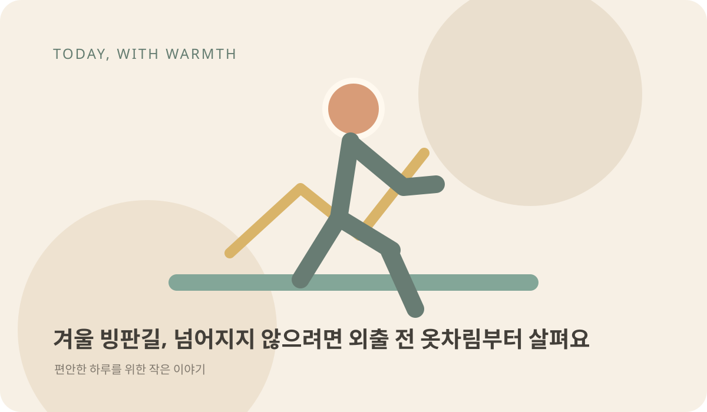

# 겨울 빙판길, 넘어지지 않으려면 외출 전 옷차림부터 살펴요

> **한 줄 요약:** 2026년 11월 19일 수능일 아침 체감온도는 전국 대부분 지역에서 영하권으로 예보됐어요. 미끄럼에 잘 견디는 신발, 짧은 보폭, 자유로운 두 손으로 겨울 외출을 준비하세요.

> 이미지: 글 주제에 맞춰 매거진에서 직접 만든 그림입니다.

아침에 집을 나서다 유난히 차가운 바람을 만나면 걸음이 저절로 빨라져요. 하지만 길이 얼었을 때 급히 걷거나 두 손을 주머니에 넣으면 균형을 잡기 어려울 수 있습니다. **추운 날에는 멋보다 안정된 걸음과 몸의 움직임을 먼저 챙기는 것이 중요해요.**

**행정안전부는 11월 18일, 다음 날 수능일 아침 전국 대부분 지역에서 체감온도가 영하권으로 떨어지고 일부 지역에 비나 눈이 내릴 것으로 전망된다고 안내했어요.** 도로와 보행로 결빙에 대비해 정부는 제설과 안전관리를 점검했습니다.

| 외출 준비 | 이렇게 확인해요 | 피하면 좋은 행동 |
|---|---|---|
| 신발 | 발에 잘 맞고 밑창이 미끄럽지 않은지 | 굽이 높거나 헐거운 신발 |
| 보폭 | 평소보다 작게, 발바닥을 안정적으로 디디기 | 얼음 위에서 급하게 걷기 |
| 손과 가방 | 장갑을 끼고 손을 자유롭게 두기 | 두 손을 주머니에 넣거나 짐을 한쪽에 몰기 |
| 옷 길이 | 밑단이 발에 걸리지 않는지 확인 | 긴 치맛단이나 바짓단을 끌기 |
| 이동 계획 | 날씨와 길 상태를 확인하고 여유 있게 출발 | 늦었다며 뛰거나 서두르기 |

**표의 내용은 일상적인 안전 준비를 돕는 안내이지, 낙상 위험을 완전히 없애는 보장은 아닙니다.** 보행에 어려움이 있거나 최근 넘어졌다면 가족과 상의하고 의료진에게 조언을 구하세요.

## 신발과 옷차림은 ‘걷는 동작’으로 확인해요

**신발은 새것인지보다 발에 잘 맞는지가 중요합니다.** 뒤꿈치가 자꾸 빠지거나 밑창이 닳아 미끄러운 신발은 차가운 날 외출에 불편할 수 있어요. 밑창이 미끄럼에 강한지 확인하고, 처음 신는 신발은 집 안에서 먼저 걸어보세요.

**평소보다 두꺼운 양말을 신을 계획이라면 신발 안에서 발이 조이지 않는지도 확인해야 합니다.** 발가락이 움직이지 않을 정도로 꽉 끼면 보행이 불편할 수 있어요.

**바지나 치마 밑단이 바닥에 끌리면 발에 밟히거나 계단에 걸릴 수 있습니다.** 집에서 평소 외출복을 입고 몇 걸음 걸어보며 밑단이 신발 뒤나 발끝에 걸리지 않는지 확인하세요.

**보온을 위해 여러 겹 입더라도 팔과 무릎이 자유롭게 움직여야 합니다.** 너무 큰 겉옷이나 무거운 가방은 몸의 움직임을 둔하게 만들 수 있으니 외출 전에 걸음과 팔 움직임을 확인해요.

## 얼거나 젖은 길에서는 천천히 걸어요

**결빙이 의심되는 길에서는 보폭을 줄이고 천천히 걸으세요.** 발을 높이 들어 성큼성큼 내딛기보다 발바닥을 안정적으로 디디는 편이 균형을 유지하는 데 도움이 됩니다. 손은 주머니 밖으로 꺼내고 장갑을 끼면 추위를 덜 느끼면서 손을 자유롭게 둘 수 있어요.

**양손에 무거운 짐을 들고 걷거나 휴대전화를 보며 이동하는 행동은 피하세요.** 꼭 통화를 해야 한다면 안전한 곳에 멈춰서 하거나, 동행자에게 잠시 도움을 요청해도 괜찮습니다.

**계단이나 경사로에서는 난간을 이용하고, 눈이나 물기가 남은 입구에서는 미끄럼 방지 매트가 있는지 살펴보세요.** 보행로가 얼어 위험해 보이면 조금 돌아가더라도 밝고 정리된 길을 선택하는 것이 낫습니다.

**늦을 것 같아도 뛰지 않는 것이 겨울길의 중요한 약속입니다.** 약속 시간보다 조금 일찍 출발해 추운 날씨와 교통 상황에 대비해보세요.

## 혹시 넘어졌다면 서두르지 말고 상태를 살펴요

**넘어진 직후에는 주변이 부끄럽다는 생각에 급하게 일어나려 하기 쉬워요.** 먼저 통증이 있는지, 머리나 목·허리·엉덩이를 부딪쳤는지 살펴보고 몸을 무리하게 움직이지 마세요.

**심한 통증, 머리 부딪힘, 움직이기 어려움이 있으면 혼자 일어나려 하지 말고 주변 사람에게 도움을 요청해야 합니다.** 한국에서는 긴급한 상황일 때 119에 연락하고, 의료 판단은 의료진에게 맡기세요.

**넘어진 뒤 통증이나 어지럼이 계속되거나 걷기가 불편하면 보호자에게 알리고 의료기관에 문의하는 것이 좋습니다.** 겉으로 큰 상처가 없어 보여도 증상이 남는다면 참고 넘기지 마세요.

미국 질병통제예방센터(CDC)의 고령자 낙상 예방 자료는 균형과 근력, 복용 약, 시력과 주거 환경을 살펴보는 것을 안내해요. **반복해서 넘어지거나 균형이 걱정된다면 신발만 바꾸기보다 의료진과 함께 원인을 확인하세요.**

## 외출을 조금 더 편하게 준비하는 법

**눈이나 비가 온 다음 날에는 평소보다 이동 시간을 넉넉히 잡아보세요.** 계단이 많은 길이나 경사진 지름길보다 제설된 보도와 난간이 있는 길을 택하고, 필요한 경우 대중교통이나 가족의 동행을 부탁하는 것도 괜찮습니다.

**약속에 늦지 않으려고 뛰는 상황을 만들지 않도록 출발 시간을 조정하는 것이 좋습니다.** 외출 전 가족에게 목적지와 돌아올 시간을 알려두면 예상보다 늦어질 때 서로 안부를 확인하기 쉬워요.

**지팡이나 보행 보조기구를 평소 사용하는 분은 겨울 외출 전에 고무 부분이 닳거나 헐겁지 않은지 확인하세요.** 길이와 사용법을 임의로 바꾸기보다 담당 의료진이나 보조기구 전문가에게 맞는 방법을 물어보는 편이 안전합니다.

**보조기구가 익숙하지 않은 날에는 얼어 있는 길에서 처음 시도하지 마세요.** 사용법이 편한지 미리 확인하고, 필요하면 가족과 함께 안전한 장소에서 점검하는 것이 좋습니다.

**집 안에서도 현관 매트가 밀리지 않는지, 신발을 신고 벗는 곳에 손을 짚을 안정된 곳이 있는지 살펴볼 수 있어요.** 겨울 외출 준비는 문밖의 길뿐 아니라 집을 나서고 돌아오는 동선까지 포함합니다.

**현관과 계단 주변의 물건을 정리하면 걸려 넘어질 위험을 줄이는 데 도움이 됩니다.** 다만 손잡이나 가구를 임의로 고정하는 데 어려움이 있으면 가족이나 관리 주체에 도움을 요청하세요.

**최근에 자주 휘청거리거나 낙상이 있었다면 혼자서 원인을 짐작해 약을 끊거나 보행 방법을 바꾸지 마세요.** 복용 중인 약과 시력, 균형 상태를 의료진에게 알리고 집 안팎에서 어떤 때 불안한지 구체적으로 이야기하면 점검에 도움이 됩니다.

**반복되는 낙상은 나이 탓으로만 넘기지 말고 의료진과 상의할 신호로 받아들이세요.** CDC의 낙상 예방 안내도 근력·균형과 시력, 복용 약, 생활 공간을 함께 살펴보도록 권합니다.

## 겨울 외출 실전 체크리스트

- **날씨 보기:** 출발 전에 기온과 눈·비, 길이 얼 가능성을 확인해요.
- **신발 신기:** 뒤꿈치가 들리지 않고 밑창이 닳지 않은 신발을 골라요.
- **옷 길이 확인:** 치맛단과 바짓단이 발이나 계단에 걸리지 않게 해요.
- **손을 비우기:** 가방은 몸에 밀착해 메고, 손에는 무거운 짐을 들지 않아요.
- **시간 여유 두기:** 평소보다 천천히 걸어도 늦지 않도록 출발 시간을 조정해요.

**가족과 함께 사는 분은 서로의 외출 시간을 알려두고, 혼자 사는 부모님께는 날이 추운 날 안부를 한 번 더 물어보세요.** 작은 확인이 불편한 상황에서 도움을 빨리 요청하게 해줍니다.

## 자주 묻는 질문

### 주머니에 손을 넣고 걸으면 왜 안 되나요?

**미끄러질 때 손으로 균형을 잡기 어려워질 수 있기 때문이에요.** 장갑을 끼고 손을 밖에 두며, 필요한 물건은 가방에 넣어 양손을 자유롭게 하세요.

### 롱스커트나 긴 코트는 겨울에 피해야 하나요?

**꼭 피할 필요는 없지만 밑단이 발에 걸리지 않는지 확인해야 합니다.** 외출용 신발을 신고 걷고 계단을 오르내리며 길이를 점검하세요.

### 넘어졌는데 바로 일어나도 괜찮을까요?

**통증이나 부딪힌 부위가 있는지 먼저 살피고, 다쳤거나 움직이기 힘들면 도움을 요청하세요.** 심한 증상이나 머리·목·허리 부상이 의심되면 119에 연락하고 스스로 무리해 움직이지 마세요.

## 출처

- [대한민국 정책브리핑·행정안전부, 「수능일 체감온도 영하권…정부, 제설·긴급 수송체계 점검」, 2026년 11월 18일](https://m.korea.kr/news/policyNewsView.do?newsId=148975985)
- [미국 질병통제예방센터(CDC), STEADI 고령자 낙상 예방 자료](https://www.cdc.gov/steadi/)
- 정보 기준: 2026년 11월 18일 공개된 행정안전부 기상·안전 안내와 CDC의 일반적 낙상 예방 자료를 참고했습니다.
