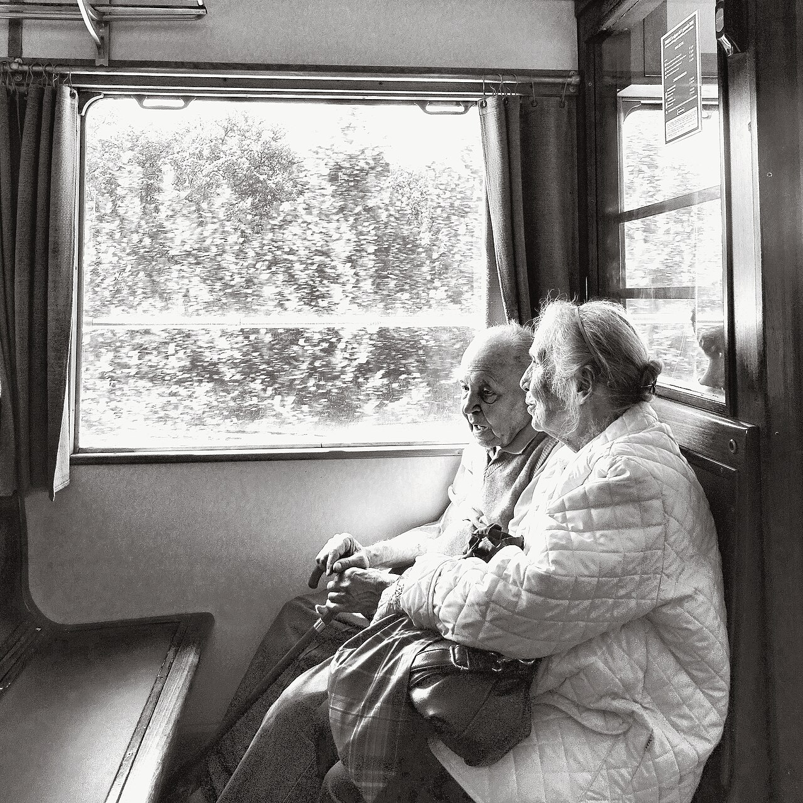

# 송년 모임 단체사진, 우리 셋이 열 번 찍고 한 장만 건진 날

> **한 줄 요약:** 사진 한 장만 찍자던 친구 셋이 바람과 타이머, 눈 깜빡임에 번갈아 당한 저녁이에요. 송년 모임의 진짜 추억은 완벽한 사진보다 그때의 웃음이더라고요.

> 이미지 출처: [Friends (50365364658)](https://commons.wikimedia.org/wiki/File:Friends_(50365364658).jpg) · CC BY-SA 2.0 · Maurizio  Costantino from Trieste, Italia

11월 바람이 제법 차가워지면 친구들 단체 채팅방에 이런 말이 올라와요. “우리 올해 안에 한 번은 얼굴 보자.” 그러면 누구는 날짜를 잡고, 누구는 식당을 찾고, 누구는 벌써 사진 찍을 옷을 걱정하지요. **우리 동네 수진 언니와 영자 씨, 미경 씨도 그렇게 송년 모임 약속을 잡았답니다.**

세 사람은 밥을 먹고 근처 공원에 잠깐 들러 단체사진을 찍기로 했어요. “사진은 딱 한 장만 찍자. 나 요즘 카메라 앞에서 어색해.” 미경 씨가 말했지요. 영자 씨가 고개를 끄덕였어요. “그래, 한 장만. 대신 그 한 장은 잘 나와야지.” **이미 ‘한 장만’이라는 말에 작은 함정이 숨어 있었어요.**

## “사진 찍기 전에 옷부터 정리하자”

**공원에 도착하자 바람이 목도리를 휙 들었다 놨어요.** 수진 언니는 코트를 여미며 말했어요. “아이고, 사진은 따뜻한 데서 찍는 줄 알았더니 바람하고 단체로 찍네.” 영자 씨는 목도리를 턱밑까지 끌어올렸고, 미경 씨는 앞머리를 두 손으로 눌렀답니다.

**셋이 사진을 찍으려는 순간마다 누군가의 머리카락이 먼저 퇴근을 했어요.** 미경 씨가 웃으며 “내 앞머리가 오늘 모임을 제일 먼저 끝내겠대”라고 하자 영자 씨가 받았지요. “그래도 넌 앞머리라도 있지. 나는 목도리가 내 얼굴을 다 가려.”

**수진 언니가 휴대전화를 꺼냈어요.** “자, 내가 타이머를 맞출게. 다들 여기 서 있어.” 그런데 화면에는 세 사람 대신 가로등만 큼지막하게 찍혔어요. 영자 씨가 고개를 갸웃했어요. “수진아, 이건 우리 모임 사진이 아니라 가로등 송별회 같다.”

**휴대전화는 분명히 사람을 찍을 준비를 했는데, 사람들은 프레임 밖에서 준비를 하고 있었지요.** 세 사람은 조금씩 뒤로 물러났고, 이번에는 화면에 나무와 벤치까지 함께 들어왔답니다.

## 타이머가 열어준 짧은 달리기

**“이번엔 10초 타이머야.** 누르면 천천히 걸어가면 돼.” 수진 언니가 말했어요. 영자 씨는 “10초면 충분하지” 하며 단추를 눌렀지요. 그런데 사진을 찍는 사람은 수진 언니였어요. 버튼을 누른 뒤 나머지 둘을 향해 뛰어가느라 코트 자락이 펄럭였답니다.

“하나, 둘, 셋!” 영자 씨가 세기 시작했지만 수진 언니는 아직 벤치 뒤를 돌고 있었어요. **찰칵 소리가 난 뒤 도착한 수진 언니는 사진에 어깨만 살짝 나왔습니다.** 미경 씨가 화면을 보고 말했어요. “이건 단체사진이 아니라 수진이 어깨 출석부야.”

**수진 언니는 숨을 고르며 억울해했어요.** “내가 버튼 누르고 뛰는 동안 너희는 왜 이렇게 천천히 세어?” 영자 씨가 웃었지요. “사진 찍히기 전에 네가 결승선에 도착할까 봐 응원하느라 그랬어.”

**다음에는 휴대전화를 벤치에 기대고 세 사람이 한꺼번에 뛰어가기로 했어요.** 그런데 이번엔 타이머를 누른 영자 씨가 걸음을 너무 빨리 옮겨서 사진이 찍히기 직전 화면을 확인하러 돌아섰답니다.

“영자야, 정면 봐!” “나 지금 정면을 찾는 중이야!” 그 순간 찰칵. 영자 씨는 옆모습, 미경 씨는 눈을 감은 모습, 수진 언니는 웃다가 입을 벌린 모습으로 남았어요. **세 사람은 사진을 보자 ‘예쁘다’는 말보다 먼저 웃음부터 터졌어요.**

## 필터는 셋을 하나로 만들었어요

**“요즘 휴대전화가 사진도 예쁘게 해준다며?” 미경 씨가 물었어요.** 수진 언니가 화면을 몇 번 누르자 얼굴에 반짝이와 꽃잎이 생겼어요. 영자 씨가 말했답니다. “어머, 이게 나야? 꽃은 많은데 내 눈은 어디 갔니?”

**다른 필터를 누르니 세 사람의 얼굴이 비슷하게 보였어요.** 수진 언니가 고개를 갸웃했어요. “이제 셋 중에 누가 영자고 누가 미경인지 내가 맞혀야겠네.” 영자 씨는 화면을 가리키며 “이 사람은 나야. 눈을 감고 있으니까.” 하고 대답했지요.

**필터가 주름을 지워도, 바람에 날린 앞머리와 눈 감은 표정까지 지우지는 못했어요.** 미경 씨는 “이렇게 찍으니 우리 셋 다 사촌 같네”라며 휴대전화를 돌려줬답니다.

마지막에는 필터를 끄고 그냥 찍어보기로 했어요. “이번엔 한 장만 더.” “그 말 아까도 했어.” “이번엔 진짜야.” **세 사람은 셀프 타이머를 누르고 어깨를 나란히 붙였어요.** 카메라가 찰칵하는 순간 바람이 다시 불었지만, 이번에는 셋 다 웃고 있었답니다.

“이번에는 누가 찍을 거야?” 영자 씨가 묻자 수진 언니가 휴대전화를 벤치에 기대며 대답했어요. “이번엔 셋이 같이 찍자. 타이머 누르고 뛰는 사람도 없고, 가로등만 나올 일도 없고.” 미경 씨가 화면을 확인했지요. “수진아, 지금 화면에 우리 발만 보여.” **세 사람은 또 한참 웃다가 휴대전화 각도를 다시 맞췄답니다.**

이번에는 얼굴도 잘 보이게 가까이 섰어요. 그런데 수진 언니가 코트를 여미느라 팔을 들자 영자 씨 목도리가 화면을 반쯤 가렸지요. 영자 씨가 얼른 목도리를 내리며 말했어요. “아이고, 이번 사진은 내가 목도리 모델로 데뷔할 뻔했네.” 미경 씨가 “모델료는 따뜻한 국물 한 그릇이면 되겠다”고 받아쳤어요. **셋은 사진을 찍기 전에 서로 얼굴을 보며 또 웃었어요.**

“자, 이제 진짜 웃어봐.” 수진 언니가 말하자 영자 씨는 너무 크게 웃어서 눈을 감고, 미경 씨는 웃음을 참느라 입을 꾹 다물었어요. 수진 언니 혼자만 환하게 웃었지요. 사진을 확인한 영자 씨가 한마디 했어요. “우리 셋이 같이 웃기로 했는데, 수진이만 혼자 행복하네.” **그 말에 이번에는 셋 다 사진보다 서로 얼굴을 보며 웃었어요.**

모임이 끝날 무렵 미경 씨가 “사진은 한 장만 건졌으니 이제 집에 가자”고 했어요. 수진 언니가 고개를 끄덕였지만, 채팅방에는 벌써 사진이 다섯 장 올라와 있었답니다. “이상하다, 한 장만 찍는다며?” 영자 씨가 묻자 수진 언니가 태연하게 답했어요. “한 장씩 다섯 번 찍었잖아.” **셋은 마지막까지 ‘한 장’의 뜻을 두고 웃으며 헤어졌답니다.**

집에 가는 길에 미경 씨가 물었어요. “다음 모임엔 사진 잘 찍는 사람을 데려오자.” 영자 씨가 바로 대답했지요. “그럼 우리 셋은 뭐 해?” 수진 언니가 웃으며 말했어요. “우리는 모델 하지. 대신 바람 없는 날로 예약해.” **그날 이후 단체 채팅방에는 ‘바람 없는 사진 촬영’이 다음 모임 안건으로 올라왔답니다.**

## 결국 제일 많이 본 사진

**집에 돌아온 뒤 단체 채팅방에 사진이 올라왔어요.** 제일 잘 나온 사진은 머리카락이 조금 흐트러지고, 한 사람은 눈을 반쯤 감은 사진이었어요. 그런데 이상하게도 셋 다 그 사진이 제일 마음에 들었지요.

영자 씨가 “이 사진은 내가 눈을 감은 게 아니라 겨울 바람을 느끼는 중이야”라고 하자, 수진 언니가 바로 답했어요. “그럼 내 어깨만 나온 사진은 어깨가 바람을 느낀 거네?” **대화방에는 웃음 표시가 줄줄이 이어졌습니다.**

**모임 사진은 얼굴을 완벽하게 보여주려고 찍는 것만은 아닌 것 같아요.** 누구는 추워서 목도리를 붙잡고, 누구는 웃느라 눈이 작아지고, 누군가는 타이머를 누르고 뛰어오는 순간까지 다 그날의 이야기니까요.

**사진 한 장을 건지려고 열 번을 찍었지만, 세 사람은 그 열 번을 더 오래 기억하게 됐어요.** 여러분도 친구들과 사진을 찍을 때 한 장이 마음에 안 들면 너무 속상해하지 마세요. 나중에 보면 가장 웃긴 사진이 가장 정다운 사진일 때가 있답니다.

## 자주 묻는 질문

### 단체사진을 자연스럽게 찍으려면 어떻게 하나요?

**한 사람이 타이머를 누르고 뛰기보다 휴대전화를 안정된 곳에 두고, 모두가 프레임을 확인한 뒤 찍으면 편해요.** 그래도 어색하면 먼저 서로 한마디씩 웃긴 말을 해보세요.

### 바람이 불 때는 어디서 사진을 찍으면 좋을까요?

**바람을 정면으로 맞는 자리보다 건물이나 나무가 바람을 막아주는 곳을 찾아보세요.** 단, 통행을 막거나 위험한 곳에 휴대전화를 세우지 않는 게 좋아요.

### 사진이 마음에 안 들면 꼭 다시 찍어야 하나요?

**다시 찍어도 좋지만, 웃음이 담긴 사진도 충분히 소중한 추억이에요.** 모두가 편안한 표정이라면 머리카락 한 올쯤 흐트러져도 괜찮답니다.

## 출처

**실제 인물이나 특정 사건을 옮긴 글이 아니라, 겨울 송년 모임의 일상을 바탕으로 새로 구성한 창작 에피소드입니다.**
