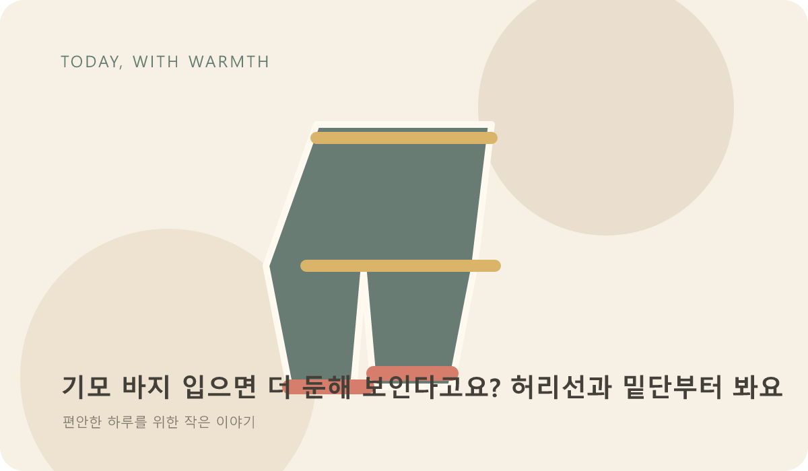

# 기모 바지 입으면 더 둔해 보인다고요? 허리선과 밑단부터 봐요

> **한 줄 요약:** 기모 바지는 두께보다 허리 위치와 바짓단, 신발과의 연결이 실루엣을 좌우해요. 살을 가리려고 큰 치수만 고르기보다 앉고 걸을 때 편한지 먼저 확인해요.

> 이미지: 글 주제에 맞춰 매거진에서 직접 만든 그림입니다.

아침저녁으로 쌀쌀해지면 손이 먼저 가는 옷이 기모 바지예요. 그런데 입고 거울을 보면 “따뜻하긴 한데 왜 다리가 더 짧아 보이지?” 싶을 때가 있죠. **바지 탓만 하기보다 허리선과 밑단이 내 몸에서 어디에 놓이는지** 같이 봐요.

| 살펴볼 곳 | 입어볼 때 확인할 점 |
| --- | --- |
| 허리 | 앉고 일어날 때 조이지 않는지 |
| 허벅지·무릎 | 당김이나 과한 가로 주름이 생기지 않는지 |
| 밑단 | 신발 위에서 뭉치거나 발목이 어색하게 끊기지 않는지 |
| 안감 | 따뜻함과 움직임을 함께 만족하는지 |

## 기모 바지는 두께보다 선을 살펴요

기모가 들어간 옷은 안쪽 감촉과 두께가 제품마다 달라요. 두꺼운 안감에 겉감까지 빳빳하면 다리의 움직임이 뻣뻣해 보일 수 있고, 지나치게 넉넉한 통은 상의까지 부피가 있을 때 전체가 커 보일 수 있어요. **두께와 통을 함께 살펴야 하는 이유예요.**

반대로 딱 붙는 치수가 늘 편한 것도 아니에요. 앉았을 때 허리가 조이거나 무릎이 당기면 하루 종일 손이 가니까요. **거울 앞에서 서 있는 모습뿐 아니라 앉고 일어서는 느낌도 꼭 확인해요.**

## 피팅룸에서 확인할 세 가지

첫째, 허리선이 배를 누르지 않는지 살펴봐요. 밴드가 편하더라도 너무 아래로 흘러내리면 상의와 바지 사이가 어색해 보일 수 있어요. **상의를 살짝 넣었을 때 허리선이 자연스럽게 이어지는지**도 봐요.

둘째, 허벅지와 무릎에 가로 주름이 과하게 잡히는지 확인해요. 주름이 당김 때문인지, 품이 남아서 생기는지에 따라 편한 치수가 다를 수 있어요. **주머니 입구가 벌어지거나 지퍼 주변이 당기면 한 번 더 걸어봐요.**

셋째, 밑단이 신발을 덮어 뭉치지 않는지 봐요. 바지 길이가 길면 발목 쪽이 무거워 보일 수 있고, 너무 짧으면 양말과 신발이 끊겨 보일 수 있어요. **자주 신는 운동화나 부츠와 함께 입어보면 선택이 쉬워져요.**

## 체형 고민별로 이렇게 맞춰봐요

배가 신경 쓰인다면 허리를 강하게 조이는 밴드보다 앉았을 때 편안한 허리 구조를 먼저 찾아요. **긴 상의와 함께 입을 때는 바지 통을 너무 크게 하지 않고**, 옆선이 곧게 떨어지는 디자인을 비교해보세요.

허벅지가 신경 쓰이면 몸에 딱 붙는 기모 레깅스 하나로 결정하지 말고, 허벅지에서 무릎까지 여유가 자연스럽게 이어지는 바지도 입어봐요. 다리가 짧아 보인다면 상의 밑단을 조금 정리하고 바지와 신발 색을 비슷한 톤으로 맞춰 **시선이 중간에서 끊기지 않게** 해보세요.

## 상의와 신발까지 함께 맞춰봐요

기모 바지는 바지 하나만 놓고 보면 괜찮아도, 입고 나왔을 때 상의 길이나 신발과 어울리지 않을 수 있어요. 긴 니트처럼 넉넉한 상의를 입는 날에는 바지 통을 너무 크게 하지 않고, 상의가 짧거나 몸에 가까운 핏이라면 허리선과 밑단이 매끄럽게 이어지는지 비교해봐요. **위아래의 부피가 한쪽에 몰리지 않게 균형을 맞추는 게 포인트예요.**

색을 고를 때는 평소 입는 코트와 자주 신는 신발을 떠올려요. 어두운 색 바지는 활용하기 쉽지만 먼지나 보풀이 잘 보일 수 있고, 밝은 색은 상의와 신발 색을 맞추기 편한 대신 오염을 살펴야 해요. **유행하는 색보다 이미 가진 옷과 여러 번 입을 수 있는지를 먼저 생각해요.**

부츠에 바짓단을 넣어 입을 계획이라면 바지 밑단이 발목에서 너무 뭉치지 않는지 확인하고, 운동화와 입을 때는 바지 길이가 바닥에 끌리지 않는지 봐요. 매장에서 다른 신발을 빌려 신기 어렵다면 평소 신는 신발 사진이나 바지와 비슷한 길이의 옷을 떠올려도 도움이 돼요. **신발까지 생각해야 집에 돌아와서 생기는 ‘왜 이 바지만 어색하지?’를 줄일 수 있어요.**

## 온라인으로 살 때는 치수표를 비교해요

온라인 상품은 ‘55’, ‘66’ 같은 표기만 보고 고르기보다 허리와 엉덩이, 허벅지, 총장 치수를 확인해요. 브랜드마다 패턴과 재는 방식이 달라 같은 표기라도 착용감이 같지 않을 수 있거든요. **평소 잘 입는 바지를 바닥에 펴고 실제 치수를 재서 상품표와 비교하면 감이 잡혀요.**

후기를 읽을 때는 키와 평소 입는 사이즈만 보지 말고, 허리 밴드의 조임이나 안감 두께, 세탁 후 변화에 대한 내용을 찾아봐요. 사진 후기는 조명과 자세에 따라 색이나 핏이 다르게 보일 수 있어요. **한 사람의 후기를 정답으로 삼기보다 여러 후기에 반복해서 나오는 장단점을 살펴봐요.**

교환·반품 조건도 결제 전에 확인해요. 택을 떼거나 세탁하면 반품이 제한될 수 있고, 배송비 부담이나 기간도 판매처마다 달라요. **받자마자 실내에서 입어보고 움직임을 확인한 뒤 구매를 결정하면 더 안전해요.**

## 세탁과 보관도 핏을 지켜줘요

기모 바지는 겉감과 안감의 소재가 다를 수 있어 세탁 전에 라벨을 확인해야 해요. 물 온도나 건조기 사용 여부를 임의로 정하면 줄어들거나 안감이 뭉칠 수 있거든요. **관리 표시가 가장 우선이고, 세탁망 사용이나 뒤집어 세탁하는 방법도 제품 안내를 따라야 해요.**

겨울옷을 정리할 때는 완전히 말린 뒤 보관하고, 무거운 옷을 위에 오래 쌓아 안감이 눌리지 않게 해요. 보풀이 생겼다면 무리하게 잡아당기지 말고 소재에 맞는 관리법을 확인해요. **옷을 오래 입는 방법은 비싼 제품을 고르는 것보다 관리표를 지키는 데서 시작해요.**

## 외출 일정에 맞춰 코디를 바꿔봐요

동네에 잠깐 나가는 날은 오래 걸어도 허리가 편하고 주머니를 쓸 수 있는 바지가 실용적이에요. 상의까지 두꺼우면 부피가 커질 수 있으니 코트 안에서 소매가 겹치거나 팔을 들 때 당기지 않는지도 확인해요. **따뜻함만큼 움직이기 편한지가 겨울 외출을 좌우해요.**

가족 모임이나 약속이 있는 날에는 평소 입는 니트나 재킷과 함께 바지를 맞춰봐요. 상의를 살짝 넣어 허리선을 보이게 할지, 밖으로 꺼내 입을지에 따라 바지 통과 밑단의 느낌이 달라져요. **거울에서는 앞모습뿐 아니라 옆모습과 뒷모습도 살펴보면 균형을 잡기 쉬워요.**

실내에 들어가면 난방 때문에 더울 수 있으니, 바지 안에 여러 겹을 무리하게 겹쳐 입기보다 실내외 온도에 맞춰 조절할 수 있는 옷을 생각해요. **기모가 두껍다는 이유로 무조건 따뜻하다고 보기보다 내가 머무는 장소와 활동량을 함께 따져요.**

기모 바지를 처음 입었을 때 허리가 편해도, 외투를 입고 가방을 메면 허리선이 달라 보일 수 있어요. **가능하다면 평소 입는 상의와 외투를 함께 걸쳐보고 팔을 움직여봐요.**

겨울에는 실내외 온도 차가 커서 바지 안에 옷을 여러 겹 입으면 실내에서 답답할 수 있어요. **내가 주로 머무는 곳과 걷는 시간을 기준으로 안감 두께를 고르면 활용도가 높아져요.**

바지가 길어 보인다고 집에서 바로 자르기보다 먼저 세탁 라벨과 수선 가능 여부를 확인해요. 세탁 뒤 길이나 모양이 달라질 수 있고, 밑단을 줄이면 신발 위에서 보이는 느낌도 바뀔 수 있거든요. **수선 전에 자주 신는 신발과 함께 길이를 다시 맞춰봐요.**

### 사기 전 체크리스트

- 매장에서 앉기, 걷기, 계단 오르내리기를 해봐요.
- 허리 밴드가 앉을 때 접히거나 조이지 않는지 확인해요.
- 허벅지와 무릎에 당김 주름이 생기지 않는지 살펴봐요.
- 자주 신는 신발과 바짓단 길이를 함께 비교해요.
- 세탁 표시에서 건조기 사용 여부와 안감 관리법을 확인해요.

### 자주 묻는 질문

**Q. 기모 바지는 한 치수 크게 사야 하나요?**

**꼭 그렇지는 않아요.** 앉고 걸을 때 당기지 않는지, 허리와 허벅지에 편안한 여유가 있는지 입어보고 결정해요.

**Q. 다리가 짧아 보이면 어떤 부분부터 볼까요?**

**바짓단 길이와 상의 밑단, 신발 색을 함께 살펴봐요.** 색이 중간에서 크게 끊기지 않도록 맞추면 전체가 자연스러워 보여요.

**Q. 온라인에서 사이즈를 고를 때 가장 중요한 건 뭔가요?**

**제품별 실측표와 교환·반품 조건을 확인하는 거예요.** 브랜드마다 같은 사이즈 표기도 핏이 다를 수 있어요.

기모 바지는 남의 유행보다 **내가 오래 입고 움직이기 편한 한 벌**이 제일 잘 산 옷이에요. 다음에 입어볼 때는 거울 앞에서만 보지 말고, 앉았다 일어나는 순간까지 확인해보세요.
