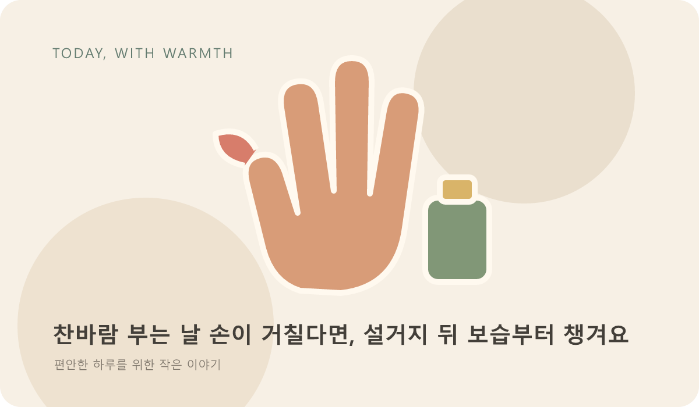

# 찬바람 부는 날 손이 거칠다면, 설거지 뒤 보습부터 챙겨요

> **한 줄 요약:** 손은 물과 세제에 자주 닿아 겨울에 건조하고 갈라질 수 있어요. 미지근한 물로 씻고 물기를 톡톡 닦은 뒤 보습제를 바르며, 증상이 계속되면 진료를 받아보세요.

> 이미지: 글 주제에 맞춰 매거진에서 직접 만든 그림입니다.

설거지를 마치고 나면 손등이 당기고 손가락 끝이 거칠어지는 날이 있어요. 날씨가 차가워지면 장갑을 끼고 물일을 하더라도 손이 자주 젖죠. **손 피부는 물과 세제에 반복해서 닿는 생활 습관의 영향을 받을 수 있어요.**

영국 국민보건서비스 [NHS 안내](https://www.nhs.uk/conditions/contact-dermatitis/)는 접촉피부염이 비누나 세제, 물과의 잦은 접촉 같은 자극으로 생길 수 있고, 손에 나타날 수 있다고 설명해요. **가려움이나 갈라짐은 원인이 여럿일 수 있으니** 생활 관리만으로 병명을 판단하지 않는 게 중요해요.

| 상황 | 손을 편하게 돌보는 순서 |
| --- | --- |
| 손 씻기 | 미지근한 물로 씻고 문지르지 않아요 |
| 물기 닦기 | 손가락 사이까지 톡톡 눌러 말려요 |
| 씻은 뒤 | 피부가 마르기 전에 보습제를 발라요 |
| 설거지·청소 | 장갑을 쓰고 땀이 차기 전에 벗어 쉬어요 |
| 증상이 계속될 때 | 자가 진단하지 말고 의료진에게 상담해요 |

## 손을 씻은 뒤 1분을 챙겨요

손을 씻을 때는 너무 뜨거운 물보다 미지근한 물을 쓰고, 수건으로 문지르지 말고 톡톡 눌러 물기를 닦아요. 손가락 사이까지 말린 뒤 보습제를 발라주세요. **씻고 난 뒤 피부가 마르기 전에 보습하는 습관**이 건조함을 줄이는 데 도움이 될 수 있어요.

향이 강한 제품이나 새 화장품을 바꾼 뒤 피부가 불편해졌다면 성분과 사용 시점을 살펴봐요. **한 번에 여러 제품을 바꾸기보다** 자극을 의심할 만한 제품을 잠시 쉬고, 증상이 반복되면 약사나 의료진과 상의하는 편이 좋아요.

## 물일할 때는 장갑도 쉬어가며 써요

설거지나 청소를 할 때는 손을 보호할 수 있는 장갑을 활용해요. 다만 장갑 안에 땀이 차면 피부가 더 불편해질 수 있으니 중간에 벗어 손을 말려주세요. 고무가 닿는 자리가 가렵다면 **면장갑을 안에 덧대는 방법**도 고려할 수 있어요.

손 피부가 이미 갈라져 따갑다면 자극이 되는 세제나 뜨거운 물에 오래 닿지 않도록 해요. NHS는 증상이 계속되거나 반복되거나 심한 경우 진료를 받도록 안내해요. **걱정되는 변화가 있으면 미루지 말고 의료진에게 보여주세요.**

## 보습제는 내 생활에 맞게 골라요

보습제는 사용감이 편하고 자주 바를 수 있는 제품인지 살펴보세요. 향이 있는 제품을 바른 뒤 따갑거나 가려운 느낌이 반복되면 사용을 멈추고 성분과 증상 변화를 확인해요. **새 제품을 여러 개 한꺼번에 시작하지 않으면 어떤 제품이 불편했는지 돌아보기 쉬워요.**

손등만 바르기 쉽지만 손가락 옆면과 손톱 주변도 건조함을 느낄 수 있어요. 손을 씻고 물기를 닦은 다음 손등과 손바닥, 손가락 사이를 부드럽게 살펴 발라주세요. **손톱 주변을 세게 문지르거나 갈라진 피부를 뜯지 않는 것도 중요해요.**

주머니나 싱크대 가까이에 작은 용기를 두면 손을 씻은 직후 보습하기 편해요. 다만 용기를 여러 사람이 함께 쓰거나 오염된 손으로 입구를 만지면 위생이 좋지 않을 수 있어요. **본인이 쓰는 자리를 정해두고, 제품 안내에 따라 보관해요.**

## 하루 일과에 맞춰 손을 쉬게 해요

아침에 외출하기 전에는 찬바람에 손이 직접 오래 노출되지 않도록 장갑을 챙겨요. 장갑 안쪽이 젖었거나 땀이 차면 잠깐 벗어 손을 말리고, 젖은 장갑은 마른 것으로 바꿔요. **보온과 통풍을 함께 챙기면 손을 덜 답답하게 관리할 수 있어요.**

요리나 설거지처럼 물에 오래 닿는 일을 할 때는 작업을 나눠 중간에 손을 쉬게 해요. 장갑을 벗은 뒤에도 세제나 물기가 손에 남지 않도록 씻고 말려주세요. **장갑만 믿기보다 물일 시간을 줄이고 손을 말리는 습관을 같이 만들어봐요.**

밤에는 손을 씻은 뒤 보습제를 바르고, 자극이 반복되는 일을 했는지 떠올려볼 수 있어요. 특정 세제나 장갑을 사용한 뒤 변화가 반복되는 것 같다면 날짜와 사용 제품을 간단히 기록해 의료진과 상담할 때 보여주세요. **기록은 원인을 혼자 확정하기 위한 게 아니라 상담을 돕기 위한 자료예요.**

## 이런 변화가 계속되면 진료를 받아요

피부가 계속 가렵거나 붉어지고, 갈라짐이나 물집이 반복되면 단순 건조함이라고만 여기지 말아요. 손 피부에 나타나는 증상은 접촉피부염 외에도 여러 원인이 있을 수 있어요. **증상이 심해지거나 일상생활을 방해하면 진료를 받아 원인을 확인하는 편이 좋아요.**

피부가 불편하다고 인터넷 사진만 보고 연고나 강한 제품을 임의로 쓰기보다 약사나 의료진에게 물어봐요. 특히 사용 중인 약이나 기존 질환이 있다면 상담할 때 함께 알려주세요. **이 글은 일반 생활 정보이며 개인별 진단이나 치료를 대신하지 않아요.**

## 손이 건조해지는 순간을 기록해봐요

손이 거칠어지는 때를 알아두면 생활 습관을 돌아보는 데 도움이 돼요. 설거지 직후인지, 청소용 세제를 쓴 날인지, 새 장갑이나 화장품을 사용한 뒤인지 간단히 메모해보세요. **언제 불편했는지 적는 일은 병명을 스스로 정하는 게 아니라 상담을 준비하는 과정이에요.**

손을 자주 씻어야 하는 생활이라면 매번 완벽한 관리법을 지키기보다, 눈에 보이는 곳에 보습제를 두고 씻은 뒤 바르는 순서를 만들어봐요. 외출용 가방이나 주방 가까이에 작은 용기를 두면 깜빡하는 일이 줄어요. **바르기 쉬운 위치에 두는 것이 꾸준히 챙기는 데 도움이 돼요.**

손톱 밑이나 손가락 사이에 물기와 세제가 남지 않도록 부드럽게 헹구고 말려요. 수건으로 세게 비비거나 종이 타월로 문지르면 피부가 더 불편하게 느껴질 수 있어요. **건조할 때는 눌러 닦고, 피부가 당기면 보습제를 덧발라요.**

보습제를 발랐는데 바로 따갑거나 붉어지는 반응이 반복된다면 참고 계속 사용하지 말아요. 제품 이름과 사용한 시점을 기록하고, 증상이 사라지지 않으면 의료진이나 약사에게 보여주세요. **제품을 바꿀 때도 사용 안내와 성분을 확인하는 습관이 필요해요.**

가족과 함께 사는 집이라면 모두 같은 세제나 손 관리 제품을 써도 각자 반응이 다를 수 있어요. 다른 사람에게 잘 맞는 제품이 내 피부에도 맞는다고 단정하지 말고, 불편함이 생기면 본인에게 맞는 방법을 상담해요. **비교보다 내 피부가 보내는 변화를 살피는 게 먼저예요.**

### 겨울 손 보습 체크리스트

- 보습제를 바를 자리를 정해 손 씻은 뒤 잊지 않게 둬요.
- 손 씻을 물은 뜨겁지 않게 조절해요.
- 손가락 사이까지 물기를 부드럽게 닦아요.
- 물일을 할 때 장갑을 쓰고, 땀이 차기 전에 잠깐 벗어요.
- 향이나 사용감이 낯선 제품은 작은 부위에 먼저 확인해요.
- 가려움과 갈라짐이 반복되면 혼자 진단하지 말고 진료를 받아요.

외출 가방에도 작은 보습제를 두고, 손 씻은 뒤 바로 쓸 수 있는지 확인해요. **손을 돌보는 순서를 생활 동선에 넣으면 꾸준히 실천하기 쉬워져요.**

### 자주 묻는 질문

**Q. 손이 트면 무조건 습진인가요?**

**아니에요.** 건조함이나 자극, 알레르기 등 원인이 다를 수 있어요. 반복되거나 심하면 진료로 확인해야 해요.

**Q. 장갑을 오래 끼면 더 좋은가요?**

**꼭 그렇지는 않아요.** 땀이 차면 불편해질 수 있으니 중간에 벗어 손을 말려주세요.

**Q. 보습제를 발라도 계속 가려우면 어떻게 하나요?**

**증상이 계속되거나 심해지면** 제품을 더 덧바르기보다 약사나 의료진에게 상담해보세요.

손이 편해야 겨울 살림도 덜 힘들어요. 오늘 설거지 뒤에는 **손을 말리고 보습제를 바르는 작은 순서**부터 챙겨볼까요?

출처:
- [NHS, 접촉피부염 원인·관리·예방 안내](https://www.nhs.uk/conditions/contact-dermatitis/)
