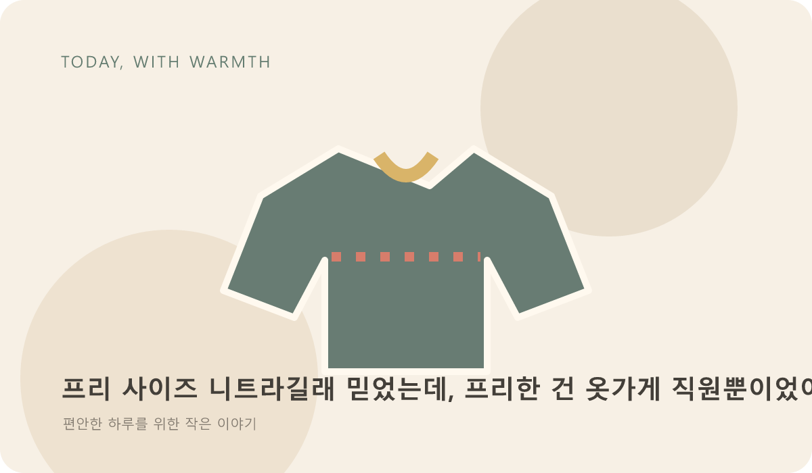

# 프리 사이즈 니트라길래 믿었는데, 프리한 건 옷가게 직원뿐이었어요

> **한 줄 요약:** “엄마, 프리 사이즈는 다 맞아”라는 말에 옷을 입어보는 순간 시작된 모녀의 겨울 쇼핑 소동. 누구에게나 편한 옷은 결국 직접 입어봐야 찾더라고요.

> 이미지: 글 주제에 맞춰 매거진에서 직접 만든 그림입니다.

겨울 니트 구경하러 딸이랑 옷가게에 갔어요. 딸이 반짝이는 눈으로 니트를 들더니 그러는 거예요. “엄마, 이거 프리 사이즈야. 누구나 다 입을 수 있어!” **그 말을 듣자마자 저는 옷걸이보다 제 어깨부터 떠올렸어요.**

제가 옷걸이를 보며 물었죠. “누구나? 그럼 옷걸이도 입을 수 있니?” **딸은 웃다가 직원 눈치를 보고, 저는 이미 한 번 입어보기로 했어요.**

## 프리 사이즈와 첫 만남

탈의실에서 니트를 꺼내는데, 목 부분부터 심상치 않아요. 머리를 넣다가 귀걸이가 걸리고, 팔을 넣으니 소매가 팔꿈치에서 잠깐 멈춰요. **밖에서 딸이 벌써 걱정스러운 목소리로 물었죠.**

**“엄마, 괜찮아?”**

“응, 지금 니트랑 서로 소개하는 중이야. **아직 손을 못 잡았어.**”

겨우 입고 거울을 봤어요. 니트는 어깨에 살짝 걸쳐 있고, 팔은 소매 안에서 길을 찾는 중이더라고요. **거울 속에서 제일 먼저 고개를 끄덕인 건 옷걸이였어요.** 딸이 다급하게 말해요. “엄마, 예쁜데?” 제가 대답했죠. “예쁘긴 한데, 내 팔은 지금 어디 갔니?”

**프리 사이즈라는 말은 편한 크기라는 뜻이지, 모든 사람에게 똑같이 잘 맞는다는 보증은 아니었어요.**

## 거울 앞에서 열린 가족회의

딸은 옆모습을 보고, 저는 팔을 들어보고, 직원은 **웃음을 꾹 참으며** 말했어요. “고객님, 원래 조금 넉넉하게 나왔어요.”

제가 한 번 더 물었죠. “그럼 제 어깨도 조금 넉넉하게 나온 건가요?” 딸이 옆에서 “엄마, 그건 원래…” 하다가 말을 흐려요. **직원은 옷걸이를 정리하는 척 고개를 숙였어요.**

팔을 앞으로 뻗으니 겨드랑이가 당기고, 앉으니 밑단이 배 위로 올라와요. **예쁘게 서 있는 사진 한 장보다 앉고 움직일 때 편한지가 먼저**라는 걸 그 자리에서 다시 배웠죠.

## 결국 제일 잘 맞는 건 입어본 옷

딸이 다른 니트를 골라줬어요. 이번엔 **어깨선이 자연스럽고 팔을 올려도 몸통이 따라 올라오지 않아요.** “엄마, 이건 어때?” 묻길래 제가 말했죠.

“이건 프리 사이즈가 아니라 **내 사이즈네.**” 딸이 웃으며 받아요. **“엄마, 그럼 이거 살까?”** 제가 말했죠. “잠깐, 가격도 프리한지 봐야지.”

결국 두 사람이 가격표를 보고 동시에 조용해졌어요. **프리한 건 옷이 아니라 계산대 앞에서 잠시 멈춘 제 마음**이었죠.

## 프리 사이즈의 기준을 물어봤어요

다른 색도 있나 싶어 직원에게 물어봤어요. “이 니트는 한 치수만 나오나요?” 직원이 고개를 끄덕이자 딸이 또 끼어들어요. “엄마, 프리 사이즈면 한 사이즈잖아.” 제가 바로 받아쳤죠. **“그래, 한 사이즈인데 왜 우리 셋 표정은 다 다르니?”**

직원이 설명해줬어요. 프리 사이즈라고 적혀 있어도 브랜드와 디자인마다 가슴둘레나 어깨 폭, 소매 길이가 다를 수 있다고요. 그 말에 제가 고개를 끄덕였어요. **프리한 건 사이즈 표기지, 내 팔 길이를 읽어주는 마법은 아니었어요.**

딸은 옷걸이에 걸린 니트를 다시 보더니 “엄마, 그럼 이건 누구한테 잘 맞을까?” 하고 묻더라고요. 제가 대답했죠. “옷걸이한테는 아주 잘 맞아. 아까부터 어깨가 딱 맞잖아.” **직원이 결국 웃음을 못 참고 고개를 돌렸어요.**

## 두 번째 니트는 팔부터 확인했어요

이번에는 니트를 입기 전에 소매 끝을 먼저 봤어요. 팔을 넣고 어깨를 한 번 돌린 다음, 양팔을 앞으로 뻗어봤죠. 딸이 밖에서 물어요. “이번엔 어때?” 제가 답했어요. **“이번엔 내 팔이 출구를 알아냈어.”**

거울 앞에서 팔을 들어보고, 가방을 메는 동작도 해봤어요. 니트가 배 위로 올라오지 않고 어깨도 편했어요. 딸이 “이제야 엄마 옷 같다”고 하길래 제가 말했죠. **“맞아, 이제 옷이 나를 입은 게 아니라 내가 옷을 입었네.”**

직원도 웃으며 “앉아보셔도 괜찮아요”라고 했어요. 의자에 앉으니 밑단이 올라오고 목이 답답한 옷도 있더라고요. 제가 딸에게 속삭였죠. “프리 사이즈는 서 있을 때만 프리한가 봐.” **딸은 웃다가 계산대를 먼저 확인했어요.**

## 집에 와서 가족 단톡방에 보고했어요

집에 도착하자마자 가족 단톡방에 사진을 올렸어요. 딸이 “엄마, 오늘 니트 잘 샀지?” 하고 묻자 아들이 답했어요. “사진만 보면 괜찮은데?” 제가 바로 썼죠. **“사진에는 내 팔이 퇴근한 장면이 안 나와.”**

딸이 그 말을 읽고 한참 웃더니 다음에는 같이 사이즈표도 보자고 했어요. 저는 “좋지, 그런데 사이즈표도 프리하면 안 돼”라고 답했죠. **가족들은 웃음 이모티콘을 보내면서도 다음 쇼핑 날짜를 잡았어요.**

그날 이후로 누가 “엄마, 이거 프리 사이즈야” 하면 저는 먼저 묻습니다. “프리한 건 사이즈야, 가격이야, 아니면 네가 고른 이유야?” **그 질문 하나면 옷가게에서 벌어질 다음 회의가 바로 시작돼요.**

## 계산대 앞에서도 회의는 계속됐어요

계산대에 서서 딸이 묻더라고요. “엄마, 진짜 괜찮아? 교환할 수 있대.” 제가 영수증을 접으며 말했죠. **“옷은 괜찮은데 내 팔이 오늘 너무 고생했어. 집에 가서 퇴근시켜야지.”** 직원이 포장 봉투를 건네며 또 웃음을 참았어요.

집에 와서 남편에게 새 니트를 보여줬어요. 남편이 한참 보더니 “그게 프리 사이즈야?” 묻길래 제가 대답했죠. “응, 프리 사이즈야.” 남편은 고개를 끄덕였어요. **“그럼 가격도 프리했어?” 그 말에 딸이 방에서 “아빠, 그 질문은 지금 하지 마!” 하고 외쳤어요.**

옷을 벗어 옷걸이에 걸어두니 처음 탈의실에서 봤던 그 옷걸이가 떠올랐어요. 딸이 “엄마, 결국 옷걸이가 제일 잘 어울리네”라고 하길래 제가 말했어요. **“그러게. 다음엔 옷걸이한테 먼저 입혀보고 나도 입어볼까?”** 그날 저녁 가족 단톡방은 니트보다 옷걸이 사진으로 더 시끌시끌했어요.

며칠 뒤 외출 준비를 하다가 그 니트를 다시 입어봤어요. 이번엔 안에 얇은 옷을 입고 천천히 팔을 넣으니 첫날보다 훨씬 편했어요. 딸에게 “봐, 오늘은 팔이 출근했어”라고 했더니 딸이 웃으며 물었죠. **“엄마, 오늘은 팔이 정시 출근했어?” 저는 “응, 지각비는 니트한테 받았어”라고 답했어요.**

옷가게에서 사이즈를 고를 때마다 몸을 탓할 필요는 없더라고요. 옷마다 어깨와 소매, 길이가 다르고, 우리 몸도 각자 편한 기준이 있으니까요. **프리 사이즈가 나를 평가하는 시험지는 아니니, 편한지 먼저 입어보고 결정하면 돼요.**

### 옷가게에서 자주 나오는 모녀 질문

**Q. 딸이 “엄마, 이거 프리 사이즈야”라고 하면요?**

**“그래, 그럼 엄마 팔도 프리하게 들어가는지 보자” 하고 탈의실로 가요.** 말로는 누구나 입을 수 있어도, 소매가 팔꿈치에서 멈추면 그건 우리 집만의 현실 개그가 되거든요.

**Q. 입어봤는데 팔이 안 들어가면 제가 작은 건가요?**

**아니요, 오늘은 니트가 팔과 첫 만남에 실패한 거예요.** 다음 옷을 입어보고도 불편하면 그 옷은 옷걸이에게 양보해도 괜찮아요.

**Q. 결국 어떤 사이즈를 골라야 할까요?**

**서 있을 때 예쁜 것보다 앉고 움직일 때 편한 옷을 골라요.** 거울 앞에서 팔을 들어보고, 가격표 앞에서는 마음도 한 번 더 들어봐요.

옷가게를 나서며 딸이 “엄마, 오늘 쇼핑은 성공이야?” 하고 물었어요. 제가 봉투를 들어 보이며 말했죠. **“응, 니트도 샀고 웃음도 샀고, 옷걸이한테 잘 어울린다는 칭찬도 했어.”**

다음 겨울에는 사이즈표를 들고 가기로 했어요. 딸이 “엄마, 그럼 이번엔 프리 사이즈도 통과할 수 있겠다”고 하길래 제가 답했죠. **“그래, 사이즈표는 통과해도 내 팔은 면접을 따로 볼 거야.”**

**다음에는 딸이 “엄마, 프리 사이즈야” 하면 이렇게 물어보려고요.** “누구 기준으로 프리한데?” 여러분도 옷가게에서 사이즈와 씨름한 적 있으세요? 그때 한마디가 어땠는지 친구와 나눠봐요.
