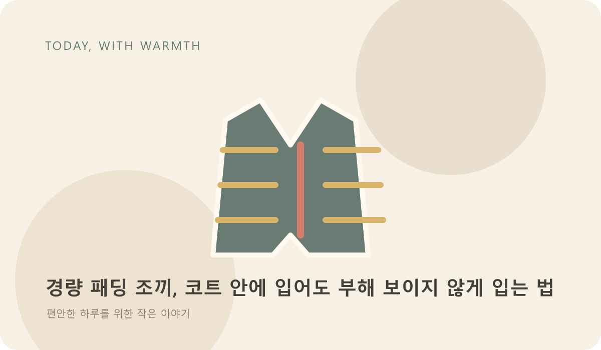

# 경량 패딩 조끼, 코트 안에 입어도 부해 보이지 않게 입는 법

> **한 줄 요약:** 경량 패딩 조끼는 누빔 간격과 길이, 목선만 잘 골라도 코트 안에서 날씬하게 정리돼요. 지퍼를 살짝 열어 세로선을 만들고, 팔을 움직여도 편한지 꼭 입어보고 골라요.

> 이미지: 글 주제에 맞춰 매거진에서 직접 만든 그림입니다.

아침 공기가 제법 매워졌어요. 코트만 입자니 등이 서늘하고, 두꺼운 패딩을 꺼내자니 아직은 이른 것 같은 요즘이잖아요. **이럴 때 옷장에서 제일 바쁜 옷이 바로 경량 패딩 조끼예요.**

그런데 막상 코트 안에 껴입고 거울을 보면 몸통이 한 겹 더 두꺼워 보여서 속상할 때가 있어요. **조끼 탓이라기보다 내 몸에 맞는 모양을 아직 못 만난 거예요.** 오늘은 조끼를 고르고 입는 기준을 하나씩 짚어볼게요.

| 살펴볼 곳 | 이렇게 고르면 편해요 |
| --- | --- |
| 누빔 간격 | 가로 칸이 좁고 촘촘할수록 부피가 덜 보여요 |
| 길이 | 코트 안에 입을 땐 골반 위에서 끝나는 길이 |
| 목선 | 코트 칼라와 겹치지 않는 브이넥이나 라운드넥 |
| 진동둘레 | 팔을 앞으로 뻗어도 겨드랑이가 끼지 않는지 |
| 색 | 코트 안쪽 옷이나 코트와 비슷한 톤 |

## 누빔 칸부터 들여다봐요

패딩 조끼는 겉에 보이는 누빔 칸이 실루엣을 많이 좌우해요. 칸이 넓고 통통하게 부풀어 있으면 가로줄이 크게 강조돼서 몸통이 옆으로 넓어 보이기 쉬워요. **같은 조끼라도 칸이 좁고 납작한 쪽이 코트 안에서 훨씬 얌전해요.**

요즘은 가로 누빔 말고도 사선이나 물결 모양, 바느질선이 거의 안 보이는 디자인도 많아요. 상체에 볼륨이 있는 편이라면 이런 디자인을 한번 입어보세요. **가로줄이 덜 보이면 시선이 옆으로 퍼지지 않거든요.**

## 길이는 코트와 따로 생각하지 않아요

조끼를 단독으로 입을 때와 코트 안에 입을 때는 알맞은 길이가 달라요. 코트 안에 입는다면 골반 위쯤에서 끝나는 길이가 단정해요. **코트 단추를 열었을 때 조끼 밑단이 코트 밑으로 삐져나오지 않는지**가 제일 중요해요.

반대로 조끼만 입고 동네 산책을 나갈 땐 엉덩이를 살짝 덮는 길이가 편할 수 있어요. 앉을 때 허리가 덜 시리고 뒷모습도 안정적으로 보이거든요. **어떤 외투와 주로 입을지 먼저 정하면 길이 고민이 반으로 줄어요.**

## 목선은 코트 칼라와 사이좋게

스탠드칼라 조끼는 따뜻하지만, 테일러드 코트나 숄칼라 코트 안에 입으면 목 주변이 두 겹 세 겹 겹쳐 답답해 보일 수 있어요. **코트 안에 입을 조끼라면 칼라 없는 브이넥이나 라운드넥이 깔끔해요.**

목이 시린 게 걱정이면 조끼 대신 얇은 목도리나 스카프로 보온을 더해보세요. 목선이 열려 있어야 얼굴 아래로 세로 공간이 생겨서 **얼굴선도 한결 갸름해 보여요.**

## 지퍼는 살짝 열어 세로선을 만들어요

실내에 들어가 코트를 벗었을 때 조끼 지퍼를 끝까지 올리면 몸통이 하나의 덩어리처럼 보이기 쉬워요. 가슴 아래까지만 올리거나 아예 열어두면 안에 입은 니트가 길게 드러나요. **열린 앞섶이 만드는 세로선 하나가 키를 커 보이게 해줘요.**

이때 조끼 안 옷과 바지 색을 비슷하게 맞추면 효과가 더 커요. 예를 들어 아이보리 니트에 베이지 바지를 입고 그 위에 카멜 조끼를 걸치는 식이에요. **안쪽이 한 줄로 이어지면 조끼가 겉돌지 않고 자연스럽게 묻어나요.**

## 체형 고민별로 이렇게 맞춰봐요

배가 신경 쓰인다면 허리를 조이는 스트링 조끼보다 일자로 툭 떨어지는 모양이 편해요. 허리를 조이면 오히려 배 쪽 볼륨이 도드라질 수 있거든요. **밑단이 배 위에서 끊기지 않고 골반까지 내려오는 길이**를 골라보세요.

어깨가 좁고 처진 편이라면 어깨선이 너무 안쪽으로 파인 조끼는 피하는 게 좋아요. 어깨가 더 좁아 보일 수 있어요. **어깨 끝을 살짝 덮는 진동 라인이 상체 균형을 잡아줘요.**

어깨가 넓거나 팔뚝이 신경 쓰인다면 반대로 진동이 살짝 안쪽으로 들어간 디자인이 어깨를 정돈해줘요. 키가 아담한 편이라면 **조끼와 바지를 같은 톤으로 맞춰 위아래를 길게 이어보세요.**

## 매장에서 이 동작은 꼭 해봐요

조끼는 가볍다 보니 거울 앞에 가만히 서서 보고 바로 사기 쉬워요. 그런데 코트 안에서 팔을 움직이면 겨드랑이가 끼거나 등판이 위로 딸려 올라가는 경우가 있어요. **평소 입는 코트를 입고 가서 함께 걸쳐보는 게 제일 정확해요.**

팔을 앞으로 쭉 뻗고, 가방을 어깨에 메고, 의자에 앉았다 일어나 보세요. 장바구니를 드는 동작도 좋아요. **움직였을 때 조끼가 몸을 따라오지 않고 제자리에 있으면 잘 맞는 거예요.**

## 세탁 라벨도 사기 전에 봐요

패딩 조끼는 충전재와 겉감에 따라 물세탁이 되는 것도 있고 드라이클리닝을 권하는 것도 있어요. 세탁기나 건조기를 임의로 쓰면 충전재가 한쪽으로 뭉칠 수 있어요. **관리 표시를 먼저 확인하는 게 오래 예쁘게 입는 첫걸음이에요.**

보관할 땐 압축 팩에 오래 눌러두기보다 옷걸이에 걸거나 가볍게 개어두는 편이 모양 유지에 좋아요. **충전재가 숨 쉴 공간을 남겨두면 다음 해에도 볼륨이 살아 있어요.**

### 사기 전 체크리스트

- 평소 입는 코트를 입고 가서 함께 입어봐요.
- 누빔 칸 폭과 부풀어 오른 정도를 비교해요.
- 코트 단추를 열었을 때 조끼 밑단이 삐져나오지 않는지 봐요.
- 팔 뻗기, 가방 메기, 앉았다 일어나기를 해봐요.
- 세탁 표시에서 물세탁과 건조기 사용 여부를 확인해요.

### 자주 묻는 질문

**Q. 패딩 조끼는 어두운 색이 날씬해 보이나요?**

**꼭 어두운 색이 답은 아니에요.** 안에 입는 옷이나 코트와 톤을 맞추면 밝은 색도 자연스럽게 정리돼요.

**Q. 조끼 위에 코트를 입으면 어깨가 끼는데 어떻게 하죠?**

**코트 진동이 넉넉한지부터 확인해요.** 코트가 몸에 딱 맞는 편이라면 더 얇은 조끼나 칼라 없는 디자인이 편해요.

**Q. 조끼를 단독으로 입을 때 팁이 있을까요?**

**안에 입는 니트 밑단을 조끼보다 살짝 짧게 정리해보세요.** 옷자락이 여러 겹으로 겹쳐 보이지 않아 깔끔해요.

**가볍고 따뜻한 조끼 한 벌이 겨울 외출을 훨씬 가뿐하게 해줘요.** 이번 주말엔 옷장 속 조끼를 꺼내 코트 안에 한번 입어보세요. 지퍼를 어디까지 올렸을 때 제일 예뻐 보이는지, 거울 앞에서 찾아보는 재미가 있을 거예요.
