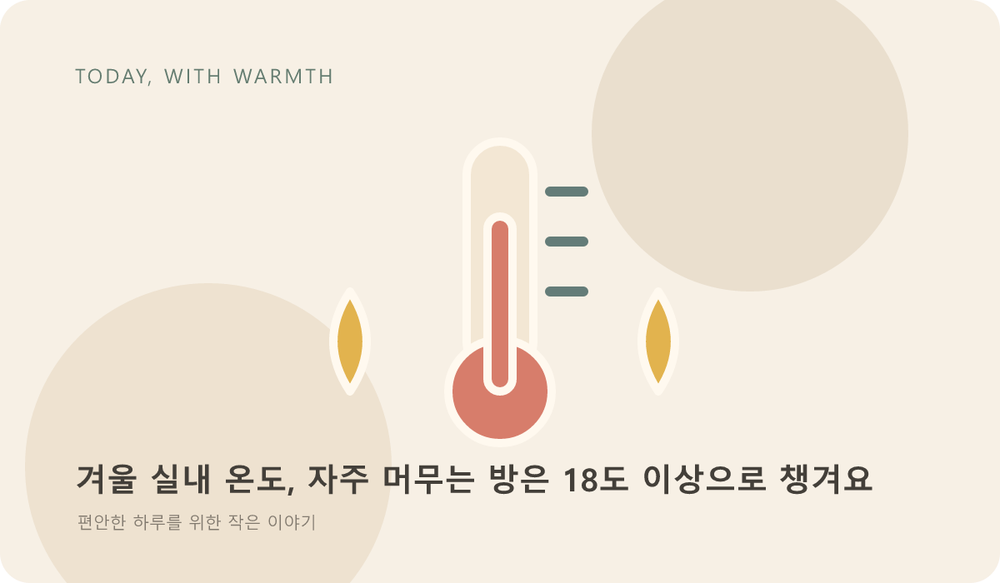

# 겨울 실내 온도, 자주 머무는 방은 18도 이상으로 챙겨요

> **한 줄 요약:** 영국 NHS는 거실과 침실처럼 자주 쓰는 방을 가능하면 18°C 이상으로 유지하라고 안내해요. 난방비가 걱정돼도 내가 오래 머무는 공간만큼은 따뜻하게 지키는 게 먼저예요.

> 이미지: 글 주제에 맞춰 매거진에서 직접 만든 그림입니다.

보일러 눈금을 올리려다 관리비 고지서가 떠올라 손을 멈춘 적 있으시죠? 내복 한 겹 더 입고 버티면 된다 싶다가도, 저녁 무렵이면 어깨가 움츠러들고 손발이 차가워져요. **아끼는 건 좋지만, 몸이 추위를 견디는 데도 한계가 있어요.**

영국 국민보건서비스 [NHS의 겨울철 건강 안내](https://www.nhs.uk/live-well/seasonal-health/keep-warm-keep-well/)는 집을 편안한 온도로 데우되, **가능하다면 거실과 침실처럼 자주 쓰는 방은 최소 18°C**를 유지하라고 권해요. 2026년 11월에 확인한 내용이에요.

같은 안내에서 65세 이상, 오래 앓는 지병이 있는 사람 등을 추위에 더 취약한 사람으로 꼽고 있어요. **우리 또래라면 남의 얘기가 아니라는 뜻이에요.** 오늘은 집 안 온도를 똑똑하게 챙기는 방법을 함께 볼게요.

| 확인할 것 | 이렇게 챙겨요 |
| --- | --- |
| 거실·침실 온도 | 가능하면 18°C 이상, 집에 온도계 하나 두기 |
| 밤 침실 | 창문은 닫고 자기 |
| 난방·조리 기기 | 안전하게 작동하는지 점검받기 |
| 겨울 준비 | 독감 예방접종, 상비약과 처방약 미리 챙기기 |
| 이웃·가족 | 서로 안부 묻고 필요한 도움 나누기 |

## 집에 온도계부터 하나 두어요

보일러 화면에 뜨는 숫자와 실제로 내가 앉아 있는 소파 주변 온도는 다를 수 있어요. 창가나 현관 쪽은 생각보다 훨씬 서늘하거든요. **작은 실내 온도계 하나만 있어도 '느낌'이 아니라 숫자로 확인할 수 있어요.**

온도계는 바닥이나 창틀보다 앉거나 누웠을 때 내 몸이 있는 높이에 두는 게 좋아요. **내가 실제로 머무는 자리의 온도가 진짜 우리 집 온도예요.**

## 모든 방보다 '자주 쓰는 방'부터

NHS가 콕 집어 말하는 건 집 전체가 아니라 거실과 침실처럼 자주 쓰는 방이에요. 쓰지 않는 방은 문을 닫아두고, 하루 대부분을 보내는 공간을 먼저 따뜻하게 하는 거예요. **난방을 고르게 퍼뜨리기보다 머무는 곳에 모으는 셈이에요.**

낮에는 거실에서, 밤에는 침실에서 시간을 보낸다면 시간대에 맞춰 난방을 조절해보세요. 잠자리에 들기 조금 전 침실을 미리 데워두면 **차가운 이불 속에 들어가는 순간의 움츠림**이 훨씬 덜해요.

## 밤에는 침실 창문을 닫아요

환기를 좋아하는 분들은 밤에도 창문을 살짝 열어두곤 해요. 그런데 NHS는 **겨울밤에는 침실 창문을 닫아두는 게 좋다**고 안내해요.

환기가 필요하면 낮 시간, 햇볕이 들 때 짧게 창을 열어 공기를 바꿔주세요. 오래 열어두기보다 **짧고 시원하게 한 번**이 실내 온기를 지키는 데 유리해요.

## 난방기기와 가스레인지도 점검해요

겨울이 깊어지기 전에 보일러나 난방기기, 가스레인지가 안전하게 작동하는지 확인하는 것도 NHS 안내에 들어 있어요. **오랜만에 켜는 기기일수록 점검을 미루지 않는 게 좋아요.**

이상한 냄새가 나거나 불꽃 색이 평소와 다르다면 혼자 고치려 하지 말고 서비스센터나 전문 기사에게 연락하세요. 전기난로나 전기장판은 **사용 설명서의 안전 수칙**을 한 번 더 읽어두면 마음이 놓여요.

## 겨울 준비는 몸 챙기기까지

NHS는 추위를 대비하면서 해마다 독감 예방접종을 받는 것이 중요하다고 강조해요. 그리고 명절이나 연휴, 궂은 날씨 예보가 있기 전에 **필요한 처방약을 미리 받아두라**고 권해요.

눈이 많이 오거나 길이 얼면 장 보러 나가기도 쉽지 않잖아요. 며칠 버틸 수 있는 먹거리를 집에 조금 챙겨두면 **날씨 때문에 무리해서 외출하는 일**을 줄일 수 있어요.

## 서로 안부를 묻는 것도 온기예요

NHS 안내에는 친구, 이웃, 가족과 연락을 이어가고 도움이 필요한지 물어보라는 내용도 있어요. 혼자 사는 친구나 연세 많은 이웃이 있다면 **"요즘 집 따뜻해요?" 한마디**가 생각보다 큰 힘이 돼요.

추운 날 전화 한 통, 단톡방 메시지 하나로 서로의 집 온도를 챙겨보세요. **나를 챙기는 마음으로 곁에 있는 사람도 함께 챙기면 겨울이 한결 덜 시려요.**

### 겨울 실내 온도 체크리스트

- 거실과 침실에 실내 온도계를 둬요.
- 자주 쓰는 방은 가능하면 18°C 이상으로 맞춰요.
- 쓰지 않는 방은 문을 닫아둬요.
- 겨울밤에는 침실 창문을 닫고 자요.
- 보일러와 난방기기, 가스레인지 안전 점검을 받아요.
- 처방약과 며칠 치 먹거리를 미리 챙겨요.

### 자주 묻는 질문

**Q. 18°C면 너무 서늘하지 않나요?**

**18°C는 최소 기준이에요.** NHS도 먼저 내가 편안한 온도로 데우라고 해요. 추위를 많이 탄다면 더 따뜻하게 맞춰도 괜찮아요.

**Q. 내복을 두껍게 입으면 난방을 덜 해도 되지 않을까요?**

**옷을 여러 겹 입는 것도 도움이 되지만 실내 온도를 대신하긴 어려워요.** 오래 머무는 방은 따뜻하게 유지하는 걸 함께 챙겨주세요.

**Q. 집이 추워서 몸이 자주 불편하면 어떻게 하죠?**

**지병이 있거나 증상이 계속된다면 의료진과 상담해보세요.** 이 글은 일반 생활 정보이고 개인별 진단을 대신하지 않아요.

**오늘 저녁엔 거실 온도부터 한번 확인해보는 거 어때요?** 숫자를 보고 나면 보일러 눈금을 올리는 손이 덜 미안해질 거예요. 여러분 집은 지금 몇 도인가요?

출처:
- [NHS, Keep warm, keep well (겨울철 건강 안내)](https://www.nhs.uk/live-well/seasonal-health/keep-warm-keep-well/)
