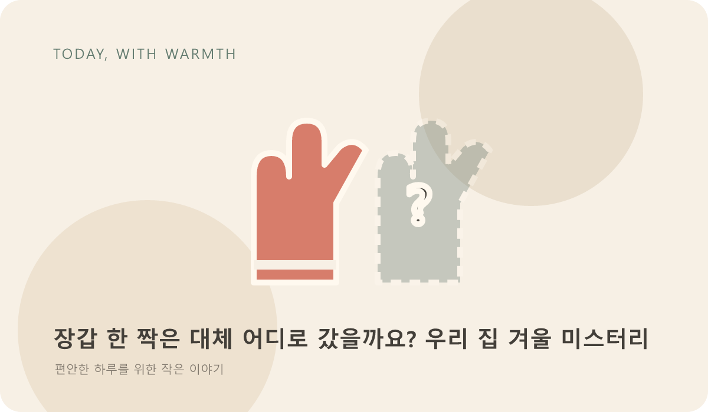

# 장갑 한 짝은 대체 어디로 갔을까요? 우리 집 겨울 미스터리

> **한 줄 요약:** 외출하려는데 장갑이 딱 한 짝만 보이는 아침, 온 식구가 탐정이 돼서 집 안을 뒤졌어요. 범인은 결국 아무도 생각 못 한 곳에 숨어 있더라고요.

> 이미지: 글 주제에 맞춰 매거진에서 직접 만든 그림입니다.

겨울만 되면 꼭 벌어지는 일이 있어요. 현관에서 신발 다 신고 가방까지 멨는데, 장갑이 오른쪽 한 짝만 손에 들려 있는 거예요. **왼쪽 한 짝은 마치 원래 없었던 것처럼 감쪽같이 사라졌어요.**

"여보, 내 장갑 못 봤어?" 거실에서 신문 보던 남편이 고개도 안 들고 그래요. "한 짝은 있잖아." **그 말에 제 입에서 김이 아니라 한숨이 먼저 나왔어요.**

## 수사는 현관에서 시작됐어요

일단 현관부터 뒤졌어요. 신발장 위, 우산꽂이 속, 택배 상자 틈까지 다 봤는데 없어요. 남편이 그제야 일어나 오더니 한다는 말이 걸작이에요. **"장갑도 겨울잠 자러 갔나 보지."**

"겨울잠은 곰이 자는 거고, 장갑은 내 손에 있어야지!" 제가 쏘아붙이니까 남편이 슬그머니 신발장 밑을 들여다봐요. **나온 건 작년에 잃어버린 남편 양말 한 짝이었어요.**

남편이 양말을 흔들며 신이 났어요. "이것 봐, 찾았잖아!" 제가 그랬죠. "그건 당신 거고, 나는 지금 장갑 찾는 중이라고." **수사는 엉뚱하게 남편 물건만 하나씩 찾아주고 있었어요.**

## 손녀 탐정이 출동했어요

마침 놀러 와 있던 초등학생 손녀가 돋보기 앱을 켜고 나타났어요. "할머니, 마지막으로 장갑 낀 게 언제예요?" **어디서 본 건 있어가지고 질문이 아주 형사 같아요.**

"어제 시장 갔다 와서 벗었지." 손녀가 고개를 끄덕이며 수첩에 뭘 적더니 "그럼 시장 가방부터 봐요" 해요. **장바구니를 뒤집었더니 대파 한 줄기랑 영수증만 우수수 쏟아졌어요.**

손녀가 대파를 들고 진지하게 말해요. "할머니, 이게 단서일 수도 있어요." 제가 웃음을 참으며 물었죠. **"대파가 장갑을 데려갔다고?"** 손녀는 끝까지 진지했어요. "대파가 마지막 목격자예요."

## 용의자가 점점 늘어났어요

남편은 고양이를 의심했어요. "저 녀석이 요즘 뭘 자꾸 물고 다니더라." 고양이는 소파 위에서 하품만 하고요. **억울한 표정이 어찌나 당당한지 수사가 잠깐 멈췄어요.**

딸한테 전화도 해봤어요. "혹시 지난주에 왔을 때 엄마 장갑 끼고 갔니?" 딸이 깔깔 웃으면서 그래요. "엄마, 나 그 장갑 끼면 손목이 반은 나와." **의심은 풀렸는데 괜히 제 손 크기만 공개됐어요.**

결국 남편이 큰 결심을 한 얼굴로 말해요. "그냥 한 짝씩 다른 걸 껴. 요즘 짝짝이가 유행이래." 제가 물었죠. **"누가 그래?" "내가 방금 정했어."**

## 범인은 바로 코트 안에 있었어요

시간은 자꾸 가고, 결국 서랍에서 다른 장갑을 꺼내 짝짝이로 끼고 나갔어요. 오른손은 회색 털장갑, 왼손은 꽃무늬 고무장갑 안에 끼던 면장갑이요. **엘리베이터 거울 속 제 모습이 꼭 겨울 마술사 같았어요.**

버스 정류장에서 추워서 코트 주머니에 손을 넣었는데, 주머니 안쪽 구멍 너머로 뭔가 말랑한 게 잡히는 거예요. 안감 사이로 쏙 빠져서 코트 밑단까지 내려가 있던 거죠. **범인은 바로 제 코트 주머니 구멍이었어요.**

정류장에서 혼자 "찾았다!" 하고 외쳤더니 옆에 계신 할아버지가 깜짝 놀라 쳐다보세요. 제가 장갑을 흔들며 설명했죠. "장갑이 코트 속에서 피난 중이었어요." **할아버지가 껄껄 웃으시며 "우리 집 사람은 리모컨이 그래요" 하셨어요.**

## 친구들 모임에서 재판이 열렸어요

그날 점심에 친구들을 만나 이 얘기를 했더니 다들 무릎을 쳐요. 한 친구는 "나는 안경 쓰고 안경 찾은 적도 있어" 하고, 다른 친구는 "나는 휴대폰 손전등 켜고 휴대폰 찾았잖아" 해요. **우리 테이블에서 제일 멀쩡한 건 앞에 놓인 커피잔뿐이었어요.**

한 친구가 판결을 내리듯 말했어요. "장갑은 무죄야. 코트가 범인이고, 주머니 구멍은 공범이고." **다들 박수를 치면서 코트 수선집 전화번호를 공유했어요.**

집에 와서 남편한테 자초지종을 말했더니 남편이 아주 의기양양해요. "봐, 내가 한 짝은 있다고 했잖아." 제가 말했죠. **"그래, 당신 양말도 찾아줬으니까 이번엔 비긴 걸로 해."**

## 우리 집 장갑 지키는 법이 생겼어요

그날 이후로 우리 집엔 새 규칙이 생겼어요. 장갑은 벗자마자 두 짝을 집게로 집어 현관 고리에 걸어두기로 했어요. **손녀가 직접 '장갑 주차장'이라고 이름표까지 붙여줬어요.**

남편은 처음엔 귀찮다더니, 일주일 지나니까 제일 열심이에요. 어제는 퇴근해서 장갑을 걸고는 저를 보며 그래요. "오늘도 두 짝 다 무사히 귀가했습니다." **그 말투가 어찌나 뿌듯한지 상이라도 줘야 할 판이에요.**

그리고 그 코트는 바로 수선집에 맡겼어요. 수선집 사장님이 주머니를 보시더니 "여기서 장갑만 나왔어요? 저는 동전 열두 개 나온 분도 봤어요" 하시더라고요. **잃어버린 줄 몰랐던 게 아직 어딘가 더 있을지도 몰라요.**

### 우리 집 장갑 수사 Q&A

**Q. 장갑 한 짝이 사라지면 어디부터 찾아야 할까요?**

**코트 주머니 안감부터 꾹꾹 눌러보세요.** 의외로 장갑이 코트 속에서 피난 중일 때가 많더라고요.

**Q. 남편이 "한 짝은 있잖아" 하면 어떻게 대답하죠?**

**"그럼 당신 신발도 한 짝만 신고 나가 봐" 하고 웃어주세요.** 그 뒤로는 수사에 아주 적극적으로 협조할 거예요.

**Q. 짝짝이 장갑 끼고 나가도 괜찮을까요?**

**괜찮아요, 사람들은 생각보다 내 손을 안 봐요.** 혹시 누가 물으면 "요즘 유행이래요" 하면 돼요. 우리 남편이 정한 유행이긴 하지만요.

**여러분 집에도 겨울만 되면 사라지는 물건이 있나요?** 장갑이든 리모컨이든 안경이든, 범인을 찾았던 이야기 있으면 친구들과 나눠보세요. 웃다 보면 추위도 잠깐 잊히더라고요.
